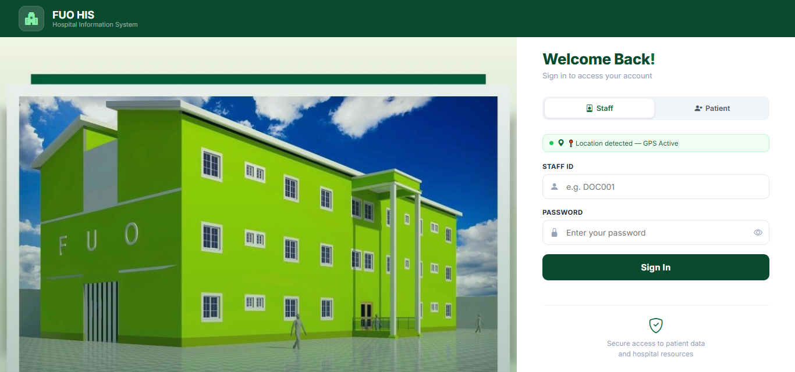

# FUO-HIS: Context-Aware RBAC Hospital Information System

A hospital information system that decides who can open a patient's record using **context as well as role**: whether the clinician is on shift, physically inside the hospital, and assigned to that patient. Every decision is logged with a risk score.

Built as a final-year project in Computer Science at Fountain University, Osogbo, and evaluated in a **simulated hospital environment with synthetic data**. It is a research prototype and is not intended for clinical use.

**Live demo:** https://fuoclinic.infinityfree.io/ (login required)



## The problem

Traditional role-based access control only asks "what is your job title?". It cannot tell whether a doctor is on duty, inside the hospital, or treating the patient whose record they are opening. That either exposes health records too widely or blocks urgent care.

## How access decisions work

Every request for a patient record goes through a policy engine:

1. **Role permission:** does the user's role hold the permission at all?
2. **Role handling:** Consultants receive full access with complete logging, and an active emergency claim can override the normal rules (see below).
3. **Three ordered context rules**, checked in this order, each with its own denial reason:
   1. **Shift:** the user must be on their scheduled shift.
   2. **Location:** the user must be within a **150 m** geofence of the hospital (browser geolocation).
   3. **Assignment:** the patient must be assigned to the user.
4. **Risk score:** calculated for every request and stored with the decision as supporting context for audits (see below).

**Emergency access:** a patient can declare an emergency, an eligible clinician claims it, and access to that patient is temporary (2 hours) and fully audited.

## Features

- 7 staff roles with a configurable role-permission matrix (administrator UI)
- Context-aware decisions using shift, GPS geofence and patient assignment
- Weighted risk scoring (Low, Medium, High, Critical) logged with every request
- Patient portal: symptom reports, diagnoses, prescriptions, lab results and emergency declaration
- Emergency claim and response workflow
- Audit log of every access, grant and denial, with filtering
- Admin dashboard with analytics charts, risk monitor, staff scheduling and patient assignment
- Session management with a 30-minute timeout and account lockout after 5 failed attempts

## Risk scoring

Weights used by the engine (a negative weight lowers the score; the minimum is 0):

| Factor | Weight |
|---|---|
| Outside hospital premises | +40 |
| Unknown or untrusted device | +30 |
| Off duty | +35 |
| Unassigned patient | +35 |
| After hours (before 07:00 or after 22:00) | +25 |
| VPN or remote access | +20 |
| Trusted network | -15 |
| Trusted device | -10 |
| On shift | -10 |
| Assigned patient | -15 |
| Role modifier: Consultant -20, Surgeon -15, Doctor -10 | |
| Active emergency override | -30 |

Bands (set in `config`): **Low** 0-20, **Medium** 21-50, **High** 51-80, **Critical** 81+. A Medium score can show a warning banner on a granted request. The grant or denial itself comes from the three ordered rules above.

## Tech stack

PHP (PDO with prepared statements), MySQL, JavaScript, Bootstrap 5 and Chart.js.

## Security measures in the code

- Passwords stored as bcrypt hashes and checked with `password_verify`
- Prepared statements for all database queries
- Output escaped with `htmlspecialchars`
- Session cookies set `httponly` and `SameSite=Strict`, random session tokens, 30-minute timeout
- Account lockout after 5 failed attempts
- Audit logging for every access decision

## Run it locally (XAMPP or WAMP)

1. Copy this folder into `htdocs/` (XAMPP) or `www/` (WAMP), for example as `ca_rbac_his`.
2. Copy `config/database.sample.php` to `config/database.php` and set your database details.
   `config/database.php` is ignored by Git, so your credentials stay private.
3. In phpMyAdmin, import `database/ca_rbac_his.sql`. It creates the `ca_rbac_his` database with sample data.
4. Then import `database/updates.sql`. If your database has a different name, change the `USE` line at the top of that file first.
5. In `config/database.php`, set `HOSPITAL_LAT` and `HOSPITAL_LNG` to the coordinates of the place where you are testing. The location rule only allows access within 150 m of that point.
6. Open `http://localhost/ca_rbac_his` in your browser and allow location access when asked.

## Demo accounts (sample data only)

| Role | Staff ID | Password |
|---|---|---|
| Administrator | ADM001 | password |
| Doctor | DOC001 | password |
| Nurse | NUR001 | password |
| Pharmacist | PHARM001 | password |
| Lab technician | LAB001 | password |
| Surgeon | SURG001 | password |
| Consultant | CONS001 | password |

These accounts and all names, emails, phone numbers and patients in `database/ca_rbac_his.sql` are **synthetic**. Change the passwords before putting this anywhere other than a local test machine.

## Project structure

```
index.php            Login page
config/              Database and application settings (sample file included)
controllers/         Authentication, record creation, session keep-alive
includes/            ContextHandler (context gathering), PolicyDecisionPoint,
                     RiskEngine, AuditLogger, shared header and footer
views/               Role dashboards, patient views, admin pages
assets/              Stylesheet and JavaScript
database/            SQL schema and sample data
```

## Limitations

- Evaluated only in a simulated environment with synthetic data.
- Location checks rely on browser geolocation, which can be inaccurate indoors.
- Not hardened or reviewed for real clinical deployment.

## Author

**Balogun Fawaz Opeyemi**, B.Sc. Computer Science (First Class), Fountain University, Osogbo.
Supervisor: Mr. I. O. Ibraheem.

## Status and licence

Shared for viewing and evaluation. No open-source licence has been granted yet, so all rights are reserved. A manuscript based on this work is under review.
